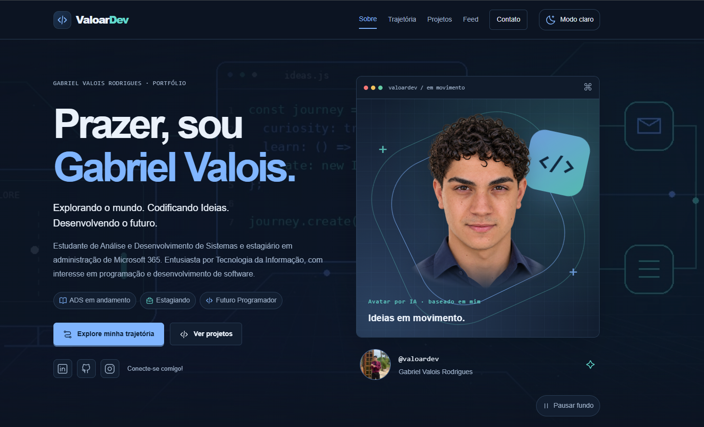

<div align="center">

# 👨‍💻 ValoarDev | Portfólio

**Explorando o mundo. Codificando ideias. Desenvolvendo o futuro.**

Um espaço para compartilhar minha trajetória em tecnologia, meus projetos e os aprendizados de cada etapa.

[](https://valoardev.github.io/portfolio_valoardev)
[](https://www.linkedin.com/in/biel-valois)
[](https://github.com/valoardev)

</div>

---

## ✨ Conheça o portfólio

[](https://valoardev.github.io/portfolio_valoardev)


## 🙋‍♂️ Sobre mim

Prazer, sou **Gabriel Valois Rodrigues**, também conhecido como **ValoarDev**.

Sou estudante de **Análise e Desenvolvimento de Sistemas** e estagiário em **administração de Microsoft 365**. Minha trajetória começou no suporte técnico, onde desenvolvi experiência com atendimento, investigação de problemas e administração de contas e serviços.

Hoje, sigo ampliando meus conhecimentos em **programação, automações e desenvolvimento de software**, conectando o que estudo aos desafios que encontro na prática.

Este portfólio acompanha essa evolução.

## 🧭 O que você encontra por aqui

| Seção | Conteúdo |
|---|---|
| **Apresentação** | Quem sou, minha formação e meus interesses. |
| **Trajetória** | Etapas profissionais, atividades e aprendizados. |
| **Projetos** | Trabalhos práticos, tecnologias, imagens e demonstrações. |
| **Tecnologias** | Ferramentas que utilizo e assuntos que quero explorar. |
| **Em desenvolvimento** | Projetos em andamento e próximos passos. |
| **Feed** | Eventos, conquistas e registros do meu aprendizado. |
| **GitHub** | Contribuições e repositórios atualizados. |
| **Contatos** | Canais para conversar e trocar ideias. |

## 🛠️ Tecnologias do site

<div align="center">


</div>

O projeto utiliza **HTML, CSS e JavaScript**, com Bootstrap para apoiar a interface responsiva. A hospedagem é feita no **GitHub Pages**, sem necessidade de backend ou etapa de compilação.

## 🎨 Recursos da interface

- 🌙 Alternância entre os temas claro e escuro.
- 🎬 Vídeo de fundo na apresentação, com controle de reprodução.
- 🗺️ Trajetória interativa com detalhes de cada etapa.
- 🪟 Cartões e galerias inspirados em janelas do macOS.
- 🗂️ Filtros por categoria e navegação lateral entre projetos e publicações.
- 🖼️ Galerias de imagens e vídeos nas páginas dos projetos.
- 📱 Layout responsivo para diferentes tamanhos de tela.
- 🟩 Painel com atividade pública do GitHub.

## 🚀 Projetos apresentados

| Projeto | Proposta |
|---|---|
| **Scripts de administração e automação** | Automações com PowerShell para incorporações, contas, grupos e rotinas administrativas. |
| **Minha Jornada** | Projeto web da equipe **Orbit**, voltado ao acolhimento de imigrantes, oportunidades e gestão de uma ONG. |
| **Meu espaço na internet** | Este portfólio: identidade, trajetória e projetos reunidos em um único lugar. |
| **TripLog** | Proposta de planejamento de viagens por voz, desenvolvida em equipe pela **Orbit**. |
| **Senhas de atendimento em C** | Sistema de terminal para cadastro, emissão de senhas, fila por prioridade e histórico de atendimentos. |

### Em desenvolvimento

- **Planner financeiro com Telegram:** integração de uma planilha com macros e VBA a um bot, com proposta de interação em linguagem natural.
- **Conectando as peças:** projeto de aprendizado integrando JavaScript, Microsoft Graph e Power Automate.

## 📂 Organização do projeto

| Arquivo ou pasta | Responsabilidade |
|---|---|
| `index.html` | Página inicial e estrutura das seções. |
| `html/` | Páginas complementares, incluindo detalhes dos projetos. |
| `css/` | Estilos, temas, animações e responsividade. |
| `js/` | Interações, renderização, filtros e integrações. |
| `js/dados/` | Conteúdo editável de projetos, feed, tecnologias e apresentação. |
| `img/` | Imagens, logos, capturas e vídeos. |
| `vendor/` | Arquivos locais do Bootstrap. |
| `.nojekyll` | Configuração para servir os arquivos estáticos no GitHub Pages. |

## 💻 Executar localmente

1. Clone o repositório:

   ```bash
   git clone https://github.com/valoardev/portfolio_valoardev.git
   cd portfolio_valoardev
   ```

2. Abra a pasta no **Visual Studio Code**.
3. Use a extensão **Live Server** para abrir o `index.html`.

Também é possível iniciar um servidor local com Python, dentro da pasta do projeto:

```bash
python -m http.server 8000
```

Depois, acesse **http://localhost:8000/**.

> Não é necessário executar `npm install` ou compilar o projeto.

## 📝 Atualizar o conteúdo

O conteúdo está separado dos componentes visuais para facilitar a manutenção:

| Quero atualizar… | Arquivo |
|---|---|
| Projetos, tecnologias utilizadas, links e galerias | `js/dados/projetos.js` |
| Publicações e fotos do feed | `js/dados/feed.js` |
| Tecnologias e interesses | `js/dados/tecnologias.js` |
| Avatar, foto de perfil e vídeo de fundo | `js/dados/visual.js` |
| Apresentação e trajetória | `index.html` |

Após editar, envie as alterações para a branch configurada no GitHub Pages.

## 🔌 Integrações e recursos externos

- **GitHub REST API:** informações públicas do perfil e dos repositórios.
- **GitHub Contributions API:** calendário de contribuições.
- **Devicon via jsDelivr:** ícones das tecnologias.
- **YouTube:** acesso ao pitch do TripLog.

O feed é mantido nos arquivos do projeto; **não há importação automática de publicações do LinkedIn**.

## 🌱 Aprendizado e evolução

Este projeto registra meu desenvolvimento profissional e técnico. Entre os próximos passos está avaliar o uso de **Angular ou React** em futuras atualizações.

Algumas ilustrações e o avatar foram produzidos com apoio de inteligência artificial. O avatar foi baseado em fotos reais; imagens conceituais são identificadas nas respectivas legendas.

## 📬 Vamos conversar?

- **Portfólio:** [valoardev.github.io/portfolio_valoardev](https://valoardev.github.io/portfolio_valoardev)
- **LinkedIn:** [biel-valois](https://www.linkedin.com/in/biel-valois)
- **GitHub:** [valoardev](https://github.com/valoardev)
- **Instagram:** [biel_valois](https://www.instagram.com/biel_valois)
- **E-mail:** [biel.valois18@gmail.com](mailto:biel.valois18@gmail.com)

---

<div align="center">

**Gabriel Valois · ValoarDev**

Feito com curiosidade, código e aprendizado.

</div>
